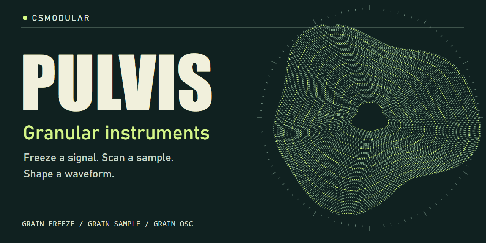

# Pulvis — Granular Synthesis Plugin for CsModular

**English** · [简体中文](README.zh-CN.md) · [Русский](README.ru.md)

<p align="center"></p>

<p align="center"><strong>Three original Csound granular synthesis modules for CsModular.</strong></p>

<p align="center">
  Version 0.0.5 ·
  <a href="https://github.com/NJyutong/csmodular-pulvis/releases/download/v0.0.5/Pulvis-0.0.5-windows-x64.exe">Windows x64</a> ·
  <a href="https://github.com/NJyutong/csmodular-pulvis/releases/download/v0.0.5/Pulvis-0.0.5-windows-arm64.exe">Windows ARM64</a> ·
  <a href="#macos">macOS</a> ·
  <a href="https://github.com/NJyutong/csmodular-pulvis/releases/download/v0.0.5/Pulvis-0.0.5-linux-x64.deb">Linux x64 (.deb)</a> ·
  <a href="https://github.com/NJyutong/csmodular-pulvis/releases/download/v0.0.5/Pulvis-0.0.5-source.zip">Source ZIP</a> ·
  <a href="https://github.com/NJyutong/csmodular-pulvis/releases/download/v0.0.5/SHA256SUMS.txt">SHA-256</a>
</p>

## Modules

- **Pulvis Grain Freeze** — Live audio granular processor and texture freezer. Records up to 8 seconds of live input, lets you freeze and scrub back in time, blend feedback, or capture a private snapshot while recording continues.
- **Pulvis Grain Sample** — Standalone WAV granular instrument with 8 sample slots. Import your own WAV files, scan forward or backward, shift pitch, and shape clouds from percussive slices to lush pads.
- **Pulvis Grain Osc** — Standalone granular synthesizer built on four band-limited waveforms (sine, triangle, saw, square) with phase warp, phase jitter, and stereo grain clouds. No audio input required.

All three modules share an original 64-voice Csound granular engine with live oscilloscope and frequency spectrum displays, per-parameter CV modulation inputs, and three interface languages (English, Simplified Chinese, and Russian).

During playback, Grain Osc shows its carrier and output waveform, Grain Freeze shows its recording or captured snapshot, and Grain Sample shows the selected WAV. The moving dots show where active grains are reading and how far they have travelled along the window curve.

## Installation

> Install the **CsModular 0.1.5** host first, and close CsModular before installing Pulvis.

### Windows (x64 & ARM64)

1. Download the setup wizard for your PC (verify with [SHA256SUMS.txt](https://github.com/NJyutong/csmodular-pulvis/releases/download/v0.0.5/SHA256SUMS.txt)):
   - **Windows x64 (Intel / AMD):** [Pulvis-0.0.5-windows-x64.exe](https://github.com/NJyutong/csmodular-pulvis/releases/download/v0.0.5/Pulvis-0.0.5-windows-x64.exe)
   - **Windows ARM64:** [Pulvis-0.0.5-windows-arm64.exe](https://github.com/NJyutong/csmodular-pulvis/releases/download/v0.0.5/Pulvis-0.0.5-windows-arm64.exe)
2. Run the setup wizard and select your CsModular `libraries/pulvis` folder.
3. Open CsModular — **Pulvis** automatically appears in the module list.
4. **Uninstall:** Use Windows *Installed apps*, or run `unins000.exe` inside the plugin folder.

### macOS

- [Download for Apple Silicon (.pkg)](https://github.com/NJyutong/csmodular-pulvis/releases/download/v0.0.5/Pulvis-0.0.5-macos-arm64.pkg)
- [Download for Intel Mac (.pkg)](https://github.com/NJyutong/csmodular-pulvis/releases/download/v0.0.5/Pulvis-0.0.5-macos-x64.pkg)

The download links will work when the installers are uploaded to the [0.0.5 release](https://github.com/NJyutong/csmodular-pulvis/releases/tag/v0.0.5).

### Linux (x64 Debian / Ubuntu)

1. Download [Pulvis-0.0.5-linux-x64.deb](https://github.com/NJyutong/csmodular-pulvis/releases/download/v0.0.5/Pulvis-0.0.5-linux-x64.deb) (standard native Debian package — no WebView, GTK, or WebKit dependencies).
2. Install with `apt`:
   ```sh
   sudo apt install ./Pulvis-0.0.5-linux-x64.deb
   ```
   System CsModular installations are detected and registered automatically. For a custom CsModular path, run `pulvis-install /path/to/csmodular/libraries`.
3. Open CsModular — **Pulvis** automatically appears in the module list.
4. **Uninstall:** Run `sudo apt remove pulvis` (automatically removes Pulvis from registered host folders).

*Upgrading from an older `granular` install:* The installer automatically migrates the folder to `pulvis`, and existing patches referencing `granular` continue to load seamlessly.

## Quick Start

1. Open **CsModular**. Press `Space` (or right-click empty canvas) to open the module browser — **Pulvis** is automatically listed with `Pulvis Grain Freeze`, `Pulvis Grain Sample`, and `Pulvis Grain Osc`.
2. **Instant sound:** Add **Pulvis Grain Osc** and connect its `L` / `R` outputs to **Outs2** `L` / `R`. Lower the output volume and press **▶** to play.
3. **Demo patch:** Load `pulvis-demo.json` (in CsModular's `patches` folder) to explore **Grain Osc → Grain Freeze → Outs2** alongside a ready-to-load **Grain Sample**.
4. **Freezing live audio (Grain Freeze):** Connect any audio source to `Audio in`, let it record, switch `Freeze` from **Record** to **Freeze**, then click **Capture** and switch `Source` to **Snapshot** to play the captured texture. Switch back to **Record** to resume recording while the snapshot plays.
5. **Using your own WAV files (Grain Sample):** Choose a slot (`#1`–`#8` on the display or the `Slot` knob), click the **Open WAV…** button on an empty slot (or right-click the module → **Load WAV → slot…**), and connect `L` / `R` to **Outs2**.

### Panel Menu (Right-Click Title Bar)

- Right-click the module title and choose **Show left-channel spectrum**. Choose **Show source** to return to the oscillator waveform, the Freeze recording or snapshot, or the selected WAV. This changes only that module’s display.
- **Language:** Switch all Pulvis panels and module menus between **English**, **简体中文**, **Русский**, or **System default** (saved on your device). The main CsModular module browser stays in English to match the host UI.
- **Panel color:** Tint any Pulvis module with 32 color presets, or click **↺ Follow theme** to restore the default matte graphite look.
- **About:** View Pulvis version, website, copyright, and MIT license.

If your module menu lacks the spectrum command, check that your CsModular host includes the updated Pulvis panels. The published 0.0.5 desktop installers predate this menu change.

## Controls

Small jacks beside knobs and selectors accept additive control-rate CV modulation. All modules work in both Voice and FX layers (keep connected cables within the same layer). Double-click a knob to restore its default. Hold **Shift** while dragging for fine adjustment.

| Control | Range / Function | CV = 1 adds |
|---|---|---|
| **Grains/s** | Grain rate: `0–24` grains/s (Freeze/Sample), `0–48` (Osc). `0` lets active grains finish | Full range (`+24` or `+48`) |
| **Size ms** | Grain duration (`2–400 ms`) | `+200 ms` |
| **Lookback / Position / Phase warp** | Freeze: scrub up to 8 s back in live history · Sample: read position in WAV · Osc: wave-cycle phase warp (`0` = pure wave) | Full span / full warp |
| **Lookback jit. / Pos. jitter / Phase jitter** | Random start-position offset per grain (Osc: random start phase) | Full span / 1 cycle |
| **Pitch st / Pitch (0=A3)** | Transposition (`−48` to `+48` semitones; `0 = 220 Hz` on Osc) | `+12` semitones |
| **Pitch jitter** | Symmetric random pitch spread (`0–24` semitones) | `+12` semitones |
| **Window** | Grain envelope shape: **Hann**, **Triangle**, or **Blackman** | `+2` |
| **Direction** | **Forward** or **Reverse** grain playback | Reverse |
| **Pan / Pan spread** | Stereo placement (`L–R`) and random stereo width (`±0.5`) | Full span |
| **Freeze / Hold pos. / Hold warp** | Freeze: **Record / Freeze** live buffer · Sample: **Follow / Hold** position & scan · Osc: **Follow / Hold** warp depth | Hold / Freeze |
| **Time jitter %** | Irregular trigger timing (`0–100%`, up to `±45%` interval scatter at constant mean rate) | `+100%` |
| **Seed** | Repeatable random sequence (`0–65534`, per module) | — |
| **Output dB** | Output level (`−24` to `+12 dB`; default `−3 dB` on Freeze, `−12 dB` on Sample/Osc) | `+12 dB` |
| **Wet mix** *(Freeze)* | Dry-to-wet blend (`0–127`) | Full wet |
| **Source** *(Freeze)* | Play from **Live** ring buffer or captured **Snapshot** | — |
| **Capture** *(Freeze)* | Copies current live ring into a private Freeze snapshot | — |
| **Feedback** *(Freeze)* | Feeds wet grains back into recording (`0–0.95`, peak-limited to `±1`) | `+0.25` |
| **Slot** *(Sample)* | Selects one of 8 session WAV slots (`#1`–`#8`) | — |
| **Scan %/s** *(Sample)* | Automatic file traversal speed (`−100%` to `+100%` per second) | — |
| **Wave** *(Osc)* | Waveform selector: **Sine**, **Triangle**, **Saw**, **Square** | — |

## WAV Support & Good to Know

- If the display moves but you hear nothing, start playback, enable **Outs2**, and follow the cables to its left and right inputs. Each connected channel plays independently. For Grain Sample, select a slot containing a WAV. For a Freeze snapshot, record some input and press **Capture** first.
- **Supported WAV formats:** 8–192 kHz, mono or stereo (stereo uses the left channel), PCM 8/16/24/32-bit, IEEE float 32/64-bit, and standard `WAVE_FORMAT_EXTENSIBLE`. RF64 and big-endian RIFX are not supported.
- **Limits:** Up to **256 MiB** and **5 minutes** per file; up to **512 MiB** of source files and **48,000,000** decoded mono frames per session.
- **Session data:** Imported WAVs are shared across Grain Sample instances during the current session and survive Stop/Start, but are **not** embedded in patch JSON files — re-import your WAV files after closing or reloading CsModular. No demo WAV is bundled; empty slots are silent.
- **Replacing samples & snapshots:** Loading a new WAV into a slot briefly restarts audio (clearing live Freeze buffers). Freeze snapshots are private to each Freeze module and reset on an audio restart.
- **CPU tip:** If playback crackles on heavy patches, reduce **Grains/s**, **Size ms**, or the number of active granular modules.

## License

Copyright © 2026 Zhang Shengwei

Pulvis is released under the **[MIT License](LICENSE)**. The granular synthesis engine is an original Csound implementation with no third-party DSP code or audio assets copied; see [SOURCES.md](SOURCES.md) for architectural references and license notes.
