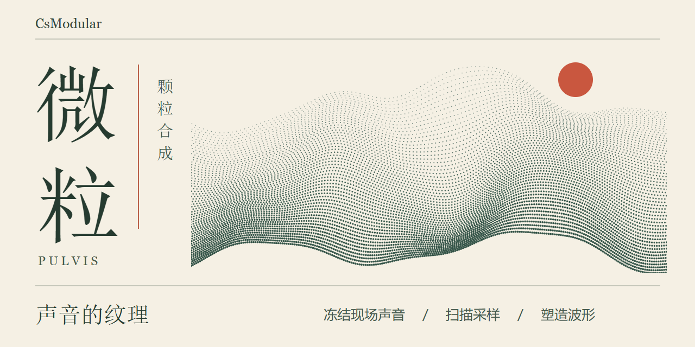

# 微粒（Pulvis）—— CsModular 颗粒合成插件

<div align="center">

[English](README.md) · **简体中文** · [Русский](README.ru.md)

</div>

<p align="center"></p>

<p align="center"><strong>把时间停驻，让音色生长。</strong></p>

<p align="center"><strong>为 CsModular 打造的原创 Csound 颗粒合成插件库，包含三个独立模块。</strong></p>

<p align="center">
  版本 0.0.5 ·
  <a href="https://github.com/NJyutong/csmodular-pulvis/releases/download/v0.0.5/Pulvis-0.0.5-windows-x64.exe">Windows x64</a> ·
  <a href="https://github.com/NJyutong/csmodular-pulvis/releases/download/v0.0.5/Pulvis-0.0.5-windows-arm64.exe">Windows ARM64</a> ·
  <a href="https://github.com/NJyutong/csmodular-pulvis/releases/download/v0.0.5/Pulvis-0.0.5-macos-arm64.pkg">macOS Apple 芯片</a> ·
  <a href="https://github.com/NJyutong/csmodular-pulvis/releases/download/v0.0.5/Pulvis-0.0.5-macos-x64.pkg">macOS Intel</a> ·
  <a href="https://github.com/NJyutong/csmodular-pulvis/releases/download/v0.0.5/Pulvis-0.0.5-linux-x64.deb">Linux x64 (.deb)</a> ·
  <a href="https://github.com/NJyutong/csmodular-pulvis/releases/download/v0.0.5/Pulvis-0.0.5-source.zip">源码包 ZIP</a> ·
  <a href="https://github.com/NJyutong/csmodular-pulvis/releases/download/v0.0.5/SHA256SUMS.txt">SHA-256 校验</a>
</p>

## 包含模块

- **微粒 · 颗粒冻结（Grain Freeze）** — 实时音频颗粒处理与声音冻结效果器。支持 8 秒实时环形录音、时间回看、干湿混音与反馈，并可将当前纹理捕捉为私有快照，同时继续录入新声音。
- **微粒 · 颗粒采样（Grain Sample）** — 独立 WAV 颗粒采样乐器，提供 8 个采样槽。导入自己的 WAV 音频后，可正向或反向自动扫描、自由移调、切碎节奏或拉出绵长氛围铺底。
- **微粒 · 颗粒振荡器（Grain Osc）** — 无需音频输入的独立颗粒合成器。内置正弦、三角、锯齿、方波四种抗混叠波形，支持相位扭曲、相位抖动与立体声颗粒云。

三个模块共用原创 64 声部 Csound 颗粒引擎，配备实时波形与频谱显示、可叠加控制率 CV 调制插孔，并支持简体中文、俄语和英语三种界面语言。

播放时，颗粒振荡器显示载波和输出波形，颗粒冻结显示录音或已捕捉的快照，颗粒采样显示所选槽位的 WAV。移动的光点标出活动颗粒的读取位置，以及它们在右侧包络曲线上的进度。

## 安装与卸载

> 请先安装 **CsModular 0.1.5** 宿主程序，安装插件前请先关闭 CsModular。

### Windows（x64 / ARM64 独立安装包）

1. 按电脑架构下载对应安装向导（可用 [SHA256SUMS.txt](https://github.com/NJyutong/csmodular-pulvis/releases/download/v0.0.5/SHA256SUMS.txt) 校验文件）：
   - **Windows x64（Intel / AMD）：** [Pulvis-0.0.5-windows-x64.exe](https://github.com/NJyutong/csmodular-pulvis/releases/download/v0.0.5/Pulvis-0.0.5-windows-x64.exe)
   - **Windows ARM64：** [Pulvis-0.0.5-windows-arm64.exe](https://github.com/NJyutong/csmodular-pulvis/releases/download/v0.0.5/Pulvis-0.0.5-windows-arm64.exe)
2. 运行安装向导，选择 CsModular 宿主中的 `libraries/pulvis` 目录。
3. 直接打开 CsModular —— **Pulvis** 插件会自动出现在模块列表中。
4. **卸载：** 在 Windows“已安装的应用”中卸载，或运行插件目录内的 `unins000.exe`。

### macOS

- [下载 Apple 芯片版 (.pkg)](https://github.com/NJyutong/csmodular-pulvis/releases/download/v0.0.5/Pulvis-0.0.5-macos-arm64.pkg)
- [下载 Intel 芯片版 (.pkg)](https://github.com/NJyutong/csmodular-pulvis/releases/download/v0.0.5/Pulvis-0.0.5-macos-x64.pkg)

安装包上传到 [0.0.5 发布页](https://github.com/NJyutong/csmodular-pulvis/releases/tag/v0.0.5) 后，以上链接即可下载。

### Linux（x64 Debian / Ubuntu）

1. 下载 [Pulvis-0.0.5-linux-x64.deb](https://github.com/NJyutong/csmodular-pulvis/releases/download/v0.0.5/Pulvis-0.0.5-linux-x64.deb)（标准原生 Debian 包，无 WebView、GTK 或 WebKit 依赖）。
2. 使用 `apt` 安装：
   ```sh
   sudo apt install ./Pulvis-0.0.5-linux-x64.deb
   ```
   系统目录下的 CsModular 会自动检测并完成注册；如宿主在自定义路径，可运行 `pulvis-install /你的/csmodular/libraries路径`。
3. 打开 CsModular —— **Pulvis** 插件会自动出现在模块列表中。
4. **卸载：** 运行 `sudo apt remove pulvis` 即可自动清理已注册的宿主插件。

*旧版升级提示：* 若之前安装过旧版 `granular` 目录，安装器会自动迁移为 `pulvis`，旧工程也能继续正常打开。

## 快速上手

1. 打开 **CsModular**，按空格键（或右键空白画布）打开模块列表，即可看到自动添加的 **Pulvis** 库（包含 `Pulvis Grain Freeze`、`Pulvis Grain Sample`、`Pulvis Grain Osc`）。
2. **立刻发声：** 放入 **微粒 · 颗粒振荡器**，将右下角 `左` / `右` 输出接到 **Outs2** 的左右输入，调低音量后点击 **▶** 播放。
3. **体验示例工程：** 通过宿主加载按钮打开 `pulvis-demo.json`（位于宿主 `patches` 目录），即可直接试听 **颗粒振荡器 → 颗粒冻结 → Outs2**，旁边还放好了待导入 WAV 的 **颗粒采样**。
4. **冻结实时声音（颗粒冻结）：** 接入音频输入并录音后，将 `冻结` 切为 **冻结**，点击 **捕捉快照** 并将 `播放来源` 切至 **快照**，即可播放这段声音。将录音切回 **录入** 后，仍可播放之前的快照。
5. **导入自己的 WAV（颗粒采样）：** 点击顶部 `#1`–`#8` 槽位（或调节 `采样槽` 旋钮），在空槽中直接点击 **导入 WAV…** 按钮（或右键模块 → **导入 WAV**），再将左右输出接到 **Outs2**。

### 模块右键菜单（右键点击模块标题栏）

- 右键模块标题栏，选择 **显示左声道频谱**。要切回振荡器波形、冻结模块的录音或快照、或当前 WAV 的波形，再次右键选择 **显示音源**。每个模块可以单独切换。
- **语言：** 一键切换所有微粒面板与模块菜单为 **简体中文**、**Русский**、**English** 或 **跟随系统**（偏好保存在本机）。宿主主模块浏览器保持英文以与宿主界面一致。
- **面板颜色：** 提供 32 种哑光配色自定义模块外观，点击 **↺ 跟随主题** 即可立即恢复默认深灰配色。
- **关于：** 查看插件版本、项目网址、版权与 MIT 许可证。

如果右键菜单里找不到频谱选项，请确认 CsModular 宿主已包含新版 Pulvis 面板。已发布的 0.0.5 桌面安装包早于这次菜单调整。

## 参数说明

旋钮和选择器旁的小插孔均为叠加型控制率 CV 输入。所有模块均可在 Voice 和 FX 层使用（注意相连模块需在同一层）。双击旋钮可恢复默认值，按住 **Shift** 拖动可微调。

| 参数 | 范围 / 作用 | CV = 1 叠加量 |
|---|---|---|
| **颗粒/秒** | 触发密度：冻结/采样 `0–24` 粒/秒，振荡器 `0–48` 粒/秒；为 `0` 时等待现有颗粒自然结束 | 满量程（`+24` 或 `+48`） |
| **粒长 ms** | 单个颗粒时长（`2–400 ms`） | `+200 ms` |
| **回看位置 / 采样位置 / 相位扭曲** | 冻结：回溯最多 8 秒录音 · 采样：WAV 读取位置 · 振荡器：波形周期相位扭曲（`0` 为纯净原波） | 满行程 / 满深度 |
| **回看抖动 / 位置抖动 / 相位抖动** | 每个颗粒起始位置的随机偏移（振荡器为起始相位随机偏移） | 满行程 / 1 周期 |
| **音高（半音） / 音高（0=A3）** | 移调范围 `−48` 至 `+48` 半音（振荡器 `0 = 220 Hz`） | `+12` 半音 |
| **音高抖动 st** | 每颗粒对称随机音高偏移（`0–24` 半音） | `+12` 半音 |
| **颗粒包络** | 颗粒窗函数：**汉宁窗**、**三角窗** 或 **布莱克曼窗** | `+2` |
| **播放方向** | **正向** 或 **反向** 播放颗粒 | 反向 |
| **声像 / 声像扩展** | 左右声像定位与随机立体声展宽（最大 `±0.5`） | 满行程 |
| **冻结 / 锁定位置 / 锁定扭曲** | 冻结：**录入 / 冻结** 环形缓冲 · 采样：**跟随 / 锁定** 位置与扫描 · 振荡器：**跟随 / 锁定** 扭曲深度 | 冻结 / 锁定 |
| **时间散布 %** | 触发时刻随机化（`0–100%`，最多偏移 `±45%` 间隔且平均粒速不变） | `+100%` |
| **随机种子** | 可复现的随机序列种子（`0–65534`，各实例独立） | — |
| **输出电平 dB** | 输出增益（`−24` 至 `+12 dB`；冻结默认 `−3 dB`，采样/振荡器默认 `−12 dB`） | `+12 dB` |
| **干湿比** *（颗粒冻结）* | 干声与颗粒湿声比例（`0–127`） | 100% 湿声 |
| **播放来源** *（颗粒冻结）* | 在 **实时** 环形缓冲与 **快照** 之间切换 | — |
| **捕捉快照** *（颗粒冻结）* | 将当前实时缓冲复制为该模块私有快照 | — |
| **反馈** *（颗粒冻结）* | 录音时将湿声颗粒回送缓冲（`0–0.95`，峰值限制在 `±1`） | `+0.25` |
| **采样槽** *（颗粒采样）* | 选择 1–8 号会话 WAV 采样槽 | — |
| **扫描 %/秒** *（颗粒采样）* | 自动遍历采样文件的速度（每秒 `−100%` 至 `+100%`） | — |
| **波形** *（颗粒振荡器）* | 选择内置波形：**正弦**、**三角**、**锯齿**、**方波** | — |

## WAV 支持与使用提示

- 如果面板有波形却听不到声音，请启动播放、打开 **Outs2** 的输出开关，并沿连线检查左右输入。只接一路时，只有对应声道出声。颗粒采样需要选中已有 WAV 的槽位。颗粒冻结要先录入声音并 **捕捉快照**，才能播放快照。
- **支持格式：** 采样率 `8–192 kHz`，单声道或立体声（立体声读取左声道），PCM 8/16/24/32 位、IEEE float 32/64 位以及标准 `WAVE_FORMAT_EXTENSIBLE`。不支持 RF64 与大端序 WAV。
- **大小限制：** 单个 WAV 最大 **256 MiB**、最长 **5 分钟**；单次运行累计最多 **512 MiB** 源文件与 **4,800 万** 解码单声道帧。
- **会话机制：** 导入的 WAV 在本次运行期间供所有颗粒采样模块共享，停止后再次播放仍会保留，但**不会**写入工程 JSON 文件——关闭或刷新 CsModular 后请重新导入 WAV。插件不内置演示 WAV，空槽默认静音。
- **替换样本与快照：** 替换 WAV 会短暂重启音频引擎并清空实时冻结缓冲；冻结快照仅归当前模块私有，音频引擎重启后需重新捕捉。
- **性能建议：** 如复杂工程出现声音断续，可适当降低 **颗粒/秒**、**粒长 ms** 或减少同时运行的颗粒模块数量。

## 许可证

Copyright © 2026 Zhang Shengwei

本项目基于 **[MIT 许可证](LICENSE)** 开源发布。颗粒合成引擎为原创 Csound 实现，未复制任何第三方 DSP 代码或音频素材；算法参考与许可记录见 [SOURCES.md](SOURCES.md)。
